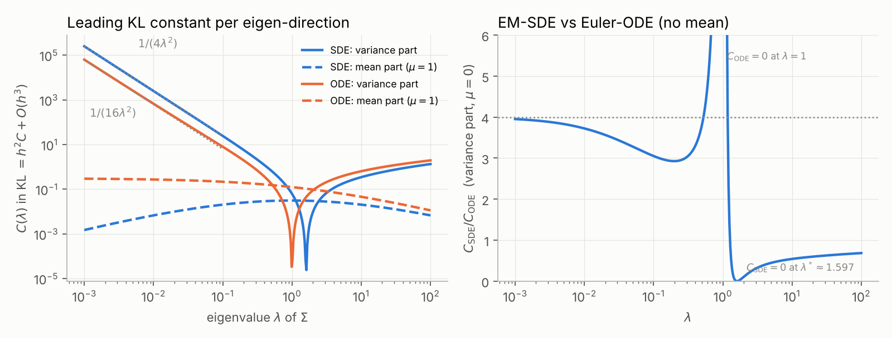
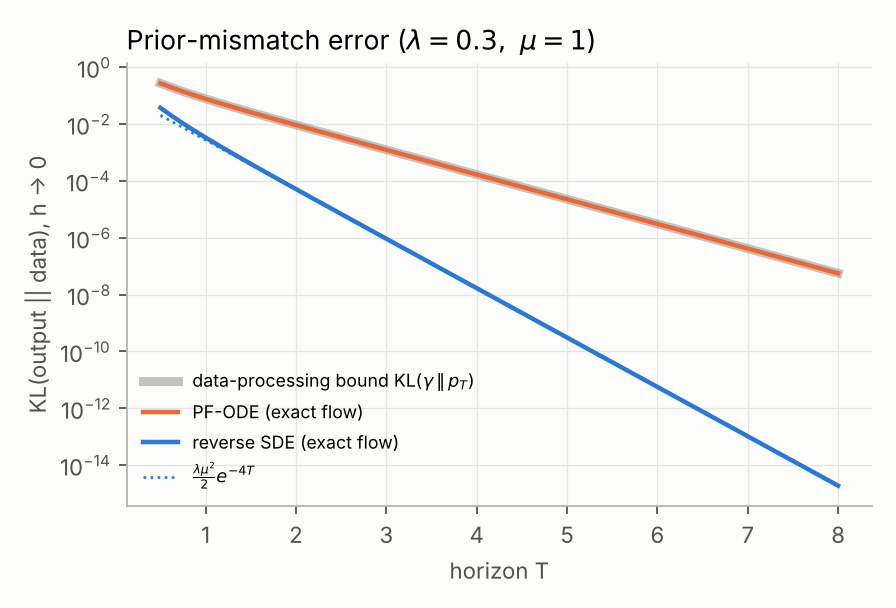
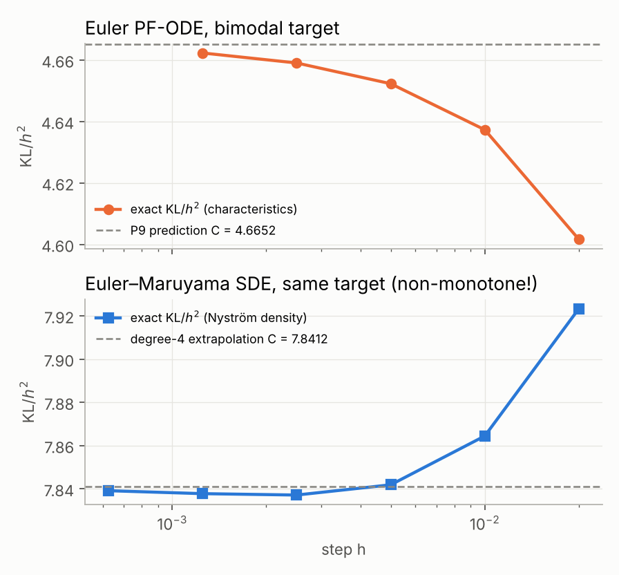
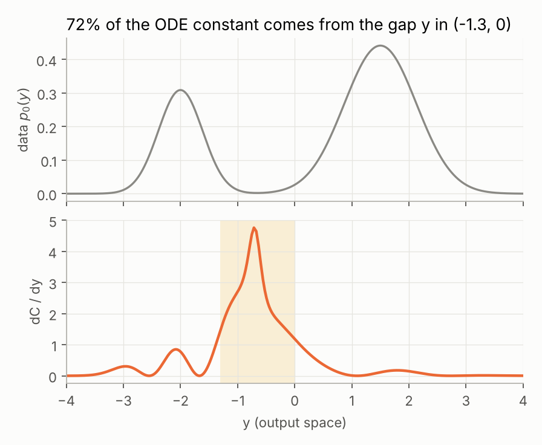

# Exact discretisation error of diffusion samplers

A self-posed problem, its solution, the code that verifies it, and an audit of how it went.
Files: `PREREGISTRATION.md` (predictions frozen before any code ran), `gaussian.py`, `mixture.py`,
`experiments.py`, `tests/` (37 tests), `AUDIT.md` (every mistake, in the order it happened), `results/`.

---

## 1. The problem

Take the VP / Ornstein–Uhlenbeck forward process $dX_t=-X_t\,dt+\sqrt2\,dW_t$ with data $X_0\sim p_0$,
so $p_t$ is $p_0$ pushed through $X_t = e^{-t}X_0+\sqrt{1-e^{-2t}}\,Z$. Sample by running, in reverse time
$s=T-t$ with a uniform step $h$ and the **exact** score $\nabla\log p_t$ queried at the left endpoint $t_k=T-kh$:

* **SDE:** Euler–Maruyama on $dY=[Y+2\nabla\log p_{T-s}(Y)]\,ds+\sqrt2\,dB$
* **ODE:** Euler on the probability-flow ODE $dY=[Y+\nabla\log p_{T-s}(Y)]\,ds$

Every error below is *pure solver error* — no score-learning error is present.

> **Question.** Exactly how large is $\mathrm{KL}(\mathrm{Law}(Y_N)\,\|\,p_0)$, how does it depend on the
> geometry of the data, and which sampler is better where?

### Goals (set before solving)

| # | Goal | Status |
|---|------|--------|
| G1 | Exact law of $Y_N$ and exact KL for Gaussian data $N(\mu,\Sigma)$ in $\mathbb R^d$, in $O(Nd)$ after one eigendecomposition | done, verified against full-matrix chain and Monte Carlo |
| G2 | Closed-form leading constant $C$ with $\mathrm{KL}=h^2C+O(h^3)$ for **both** samplers, finite $T$ | done, matches exact KL to $10^{-4}$–$10^{-8}$ relative |
| G3 | Exact prior-mismatch (initialisation) error and comparison with the data-processing bound | done |
| G4 | Behaviour as an eigenvalue $\lambda\to0$ (concentrated / near-manifold data) incl. stability | done; one prediction **refuted** |
| G5 | Numerically exact KL for a **non-Gaussian** (bimodal) target for both samplers, without Monte Carlo noise | done (Nyström density propagation; characteristics + Jacobian) |
| G6 | A first-order theory for the ODE sampler on *arbitrary* smooth 1D targets, verified on the bimodal target | done, agrees to $3\times10^{-5}$ relative |
| — | Closed form for the SDE constant on non-Gaussian targets | **not achieved** (only extrapolated numerically) |

---

## 2. Solution — Gaussian data

Because $\Sigma_t=e^{-2t}\Sigma+(1-e^{-2t})I$ commutes with $\Sigma$, everything decouples along the
eigenvectors of $\Sigma$. Fix one eigenvalue $\lambda$ and mean component $\mu$ and write

$$\sigma_t^2 = 1+q,\qquad q:=(\lambda-1)e^{-2t},\qquad \mathbb E[X_t]=e^{-t}\mu .$$

**Exact discrete law (G1).** The chain is affine-Gaussian. With $b=1-2/\sigma_t^2$ (SDE) or $\tilde b=1-1/\sigma_t^2$ (ODE):

$$m_{k+1}=(1+hb_k)m_k+h c_k,\qquad v_{k+1}=(1+hb_k)^2v_k+2h\ \ (\text{SDE}),\qquad v_{k+1}=(1+h\tilde b_k)^2 v_k\ \ (\text{ODE}).$$

**A small identity that makes the SDE tractable.** Since $b=(q-1)/(q+1)$ and $\frac{dq}{ds}=2q$,

$$b^2+\frac{db}{ds}=\frac{(q-1)^2+4q}{(1+q)^2}=1 .$$

**First-order global error (G2).** Compare one EM step with the exact variance flow $v'=2bv+2$, $v=\sigma^2$:
the local defect is $h^2\big[-(b^2+b')v-2b\big]=h^2\big[-\sigma^2-2b\big]$. It is transported to the end by
$\Phi(t)=\exp\!\int 2b\,ds=\lambda^2e^{-2t}/\sigma_t^4$ (the integral is elementary: $\int 4/\sigma_t^2\,dt=2\ln(e^{2t}+\lambda-1)$).
Substituting $q$ turns the global error into an integral of a rational function:

$$v_N-\lambda=\frac{h\lambda^2}{2(\lambda-1)}\Big[F(\lambda)-F(\sigma_T^2)\Big]+O(h^2),\qquad F(w)=-\ln w+\frac2w-\frac2{w^2}.$$

As $T\to\infty$ ($\sigma_T^2\to1$, $F(1)=0$):

$$\boxed{\;\beta_{\rm SDE}(\lambda)=\frac{2\lambda-2-\lambda^2\ln\lambda}{2(\lambda-1)}\;}\qquad\boxed{\;\alpha_{\rm SDE}=-\frac{\mu\lambda\ln\lambda}{4(\lambda-1)}\;}$$

For the ODE the natural variable is the standard deviation $r=\sqrt v$: Euler on $Y$ is exactly Euler on $r'=\tilde b r$,
whose solution is $r=\sigma_t$, propagator $\sqrt\lambda/\sigma_t$, and $\ddot r=q(2+q)/\sigma^3$:

$$\boxed{\;\beta_{\rm ODE}=-\tfrac12\,(\lambda\ln\lambda+\lambda-1)\;}\qquad
\boxed{\;\alpha_{\rm ODE}=-\frac{\mu\sqrt\lambda}{2}\int_0^1\frac{dx}{\sqrt{1+(\lambda-1)x^2}}\;}$$

(the integral is $\text{arcsinh}\sqrt{\lambda-1}/\sqrt{\lambda-1}$ for $\lambda>1$, $\arcsin\sqrt{1-\lambda}/\sqrt{1-\lambda}$ for $\lambda<1$).
Finally, KL is quadratic in small perturbations, so

$$\mathrm{KL}\big(\mathrm{Law}(Y_N)\,\|\,N(\mu,\Sigma)\big)=h^2\sum_{i=1}^d\left[\frac{\alpha(\lambda_i,\tilde\mu_i)^2}{2\lambda_i}+\frac{\beta(\lambda_i)^2}{4\lambda_i^2}\right]+O(h^3),\qquad \tilde\mu=U^\top\mu .$$

**What the formulas say (G4).**

* $\beta_{\rm SDE}(0^+)=1$, $\beta_{\rm ODE}(0^+)=\tfrac12$, so the variance part blows up like
  $C_{\rm SDE}\sim\frac{1}{4\lambda^2}$ vs $C_{\rm ODE}\sim\frac{1}{16\lambda^2}$: **for concentrated directions EM-SDE is 4× worse in KL**, and
  every sampler needs $h\ll\lambda_{\min}$ — the formal reason early stopping at $\delta$ (which floors $\lambda$ at $\approx2\delta$) is needed for manifold data.
* $C_{\rm ODE}$'s variance part vanishes at $\lambda=1$; $C_{\rm SDE}$'s vanishes at $\lambda^*\approx1.5971$ (root of $2\lambda-2-\lambda^2\ln\lambda$). For $\lambda>\lambda^*$ the SDE is the better sampler.
* The ODE's mean bias is always larger than the SDE's (2× at $\lambda=1$, $\to$ finite $\pi^2\mu^2/32$ as $\lambda\to0$ while the SDE's $\to0$).
* **Refuted prediction:** I expected EM-SDE to go unstable for $h\gtrsim\lambda$. It does not: the score is never queried at $t<h$, where $\sigma_t^2\ge1-e^{-2h}$ regardless of $\lambda$, so $|1+hb_k|\le1$ always. Small $\lambda$ costs accuracy, not stability.

**Initialisation error (G3), exact continuous flow started from $N(0,1)$:**

* SDE: $\;m-\mu=-\dfrac{\lambda e^{-2T}}{\sigma_T^2}\mu,\quad v-\lambda=\dfrac{\lambda^2(1-\lambda)e^{-4T}}{\sigma_T^4}\;\Rightarrow\;\mathrm{KL}\approx\tfrac12\lambda\mu^2e^{-4T}$.
* ODE: the flow is an affine bijection, so $\mathrm{KL}(\text{out}\,\|\,p_0)=\mathrm{KL}(N(0,1)\,\|\,p_T)\approx\tfrac12\mu^2e^{-2T}$ **exactly**.

So the data-processing bound $\mathrm{KL}\le\mathrm{KL}(\gamma\,\|\,p_T)$ is *tight* for the ODE and loose by $\sim e^{2T}/\lambda$ for the SDE: the reverse SDE forgets its initialisation at **twice** the exponential rate.

### Verification of G2 (Richardson extrapolation of the exact KL, $\mu=1$, $T=10$)

| $\lambda$ | sampler | $C$ predicted | $C$ from exact KL | rel. error |
|---|---|---|---|---|
| 0.01 | SDE | 2498.84 | 2499.17 | 1.3e-4 |
| 0.01 | ODE | 671.150 | 671.213 | 9.4e-5 |
| 0.1 | SDE | 24.3849 | 24.3854 | 1.9e-5 |
| 0.1 | ODE | 8.20094 | 8.20105 | 1.3e-5 |
| 1 | SDE | 0.0937500 | 0.0937500 | 1.2e-7 |
| 1 | ODE | 0.124989 | 0.124989 | 1.4e-8 |
| 10 | SDE | 0.368091 | 0.368091 | 6.9e-7 |
| 10 | ODE | 0.686955 | 0.686954 | 9.1e-7 |

(Residuals are the expected $O(h)$ next-order term; they shrink at first order in every case — see `test_kl_constant_richardson`.)

---

## 3. Solution — a non-Gaussian target

Target: $p_0=0.3\,N(-2,0.15)+0.7\,N(1.5,0.4)$, $T=8$, started from the exact $p_T$.
Its score and all derivatives are closed form through posterior responsibilities $r_j(y)$ with $u_j=-(y-m_j)/v_j$:

$$S=\mathbb E_r[u],\quad S'=\mathbb E_r[u']+\mathrm{Var}_r(u),\quad \partial_tS=S+yS'+S''+2SS'\ \ (\text{from Fokker–Planck}).$$

**Numerically exact KL, no Monte Carlo (G5).**

* *SDE:* propagate the density of the EM chain on a grid by Nyström discretisation of Chapman–Kolmogorov,
  $\rho_{k+1}(y_j)=\sum_i\Delta x\,\rho_k(x_i)\,\varphi_{2h}\big(y_j-x_i-hf(x_i)\big)$, with a banded kernel. Trapezoid quadrature of a smooth
  Gaussian integrand converges spectrally; on a Gaussian target it reproduces the exact recursion's KL to $3\times10^{-8}$.
* *ODE:* the chain is a deterministic map. Push a fine grid of initial points along the Euler steps carrying $\log\Phi_h'$, and integrate
  $\mathrm{KL}=\int p_T(x)\big[\log p_T(x)-\log\Phi_h'(x)-\log p_0(\Phi_h(x))\big]dx$ in *initial* coordinates (no interpolation anywhere).

**First-order theory for the ODE on any smooth 1D target (G6).** With $\Phi$ the exact flow map and $\Phi_h=\Phi+h\,e+O(h^2)$,
the global-error field obeys the variational equation along characteristics

$$\frac{de}{ds}=\big(1+S'(t,Y)\big)\,e-\tfrac12\ddot Y,\qquad \ddot Y=-\partial_tS+(1+S')(Y+S),$$

and since $\Phi_h\#p_T=(\mathrm{id}+h\varepsilon)\#p_0$ with $\varepsilon=e\circ\Phi^{-1}$,

$$\mathrm{KL}=\frac{h^2}{2}\int p_T(x)\left(\frac{e'(x)}{\Phi'(x)}+e(x)\,\partial_y\log p_0(\Phi(x))\right)^2dx+O(h^3).$$

$e'(x)$ is obtained by complex-step differentiation through the RK4 solve (exact to machine precision).

| quantity | value |
|---|---|
| $C_{\rm ODE}$ predicted (G6, converged in $dx$ and RK4 step) | **4.66523** |
| $C_{\rm ODE}$ from exact KL, polynomial extrapolation over $h\in[1.25\times10^{-3},0.02]$ | **4.66535** |
| relative disagreement | $2.6\times10^{-5}$ |
| $C_{\rm SDE}$ from exact KL, degree 3–5 extrapolation over $h\in[6.25\times10^{-4},0.02]$ | $7.8412\pm2\times10^{-4}$ |

Two findings that only show up off the Gaussian family:

1. **The ODE error lives in the gap between modes** — 72% of $C_{\rm ODE}$ comes from $y\in(-1.3,0)$, where $p_0$ is tiny.
   The exact flow map has $\Phi'\approx145$ there (it stretches a sliver of $p_T$ across the low-density valley), and Euler mis-places that sliver.
2. **EM-SDE's $\mathrm{KL}/h^2$ is non-monotone in $h$** (7.923, 7.864, 7.842, 7.8371, 7.8378, 7.8391): a small negative first-order term
   competes with a quadratic term of size $\sim10^3$. Two-point Richardson gives the wrong answer at the $10^{-3}$ level here.

---

## 4. Tests

`python3 -m pytest` — 37 tests, ~1 min. They are deliberately *independent* of the derivation wherever possible:

* exact recursion vs particle simulation of the actual chain (400k particles, 5σ bounds);
* eigen-decoupled chain vs full $d\times d$ matrix chain with a random rotation (to $10^{-12}$);
* every closed form vs `scipy.integrate.quad` of its *defining* integral, with $\dot b$ by complex step rather than by the identity it is meant to test;
* the KL constant vs Richardson extrapolation of the exact KL, including that the residual shrinks at first order;
* init-error formulas vs the $h\to0$ limit of the discrete chains; ODE init error $=\mathrm{KL}(\gamma\|p_T)$ to $10^{-10}$;
* mixture score derivatives vs complex step; $\partial_tS$ vs finite differences in $t$;
* grid solvers vs the exact Gaussian recursion; grid SDE density vs 400k-particle Monte Carlo on the mixture;
* the RK4 flow pushes $p_T$ to $p_0$ with residual decaying at 4th order;
* regression tests for both numerical bugs found during the audit.

## 5. Limitations

* No closed form for the SDE constant on non-Gaussian targets (would need a Talay–Tubaro-type expansion of the density, i.e. a PDE solve).
* G5/G6 are 1D; the characteristics method extends to $d$ dims with $\log\det$ Jacobians but the quadrature does not.
* Exact score throughout; the interaction of score error with discretisation error is not studied.
* Uniform steps only; the $1/\lambda^2$ blow-up suggests that the optimal non-uniform schedule is set by $\lambda_{\min}$ — not derived here.
